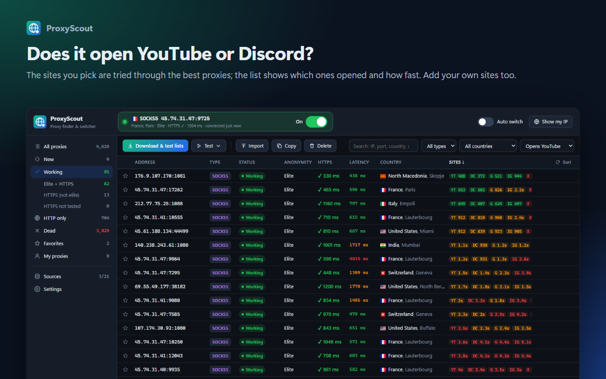

# ProxyScout — Proxy Finder & Switcher

**English** · [Türkçe](README.tr.md)

A proxy finder and switcher for Chrome, Edge, Firefox and Opera (and other Chromium browsers such as
Brave and Vivaldi). ProxyScout downloads free proxy lists from dozens of sources, really tests every
proxy over HTTP and HTTPS, and sorts the working ones by anonymity. Click a proxy and all browser
traffic goes through it; one switch turns it off again.

## Install

| Browser | Store |
| --- | --- |
| Chrome, Brave, Vivaldi |  |
| Microsoft Edge |  |
| Firefox (desktop 140+, Android 142+) |  |
| Opera | **Opera add-ons** — _awaiting review_ <!-- OPERA_LINK --> |

**Without a store (Chromium browsers):** download `proxyscout-x.y.z.zip` from the
[latest release](https://github.com/Halil-KAPLAN/ProxyScout/releases/latest) and extract it, open
`chrome://extensions` (Edge: `edge://extensions`), turn on **Developer mode** and choose
**Load unpacked** → the extracted folder.

| | |
| --- | --- |
|  |  |
|  |  |

## Features

- **21 built-in list sources** (ProxyScrape, free-proxy-list.net, Spys.me, monosans, TheSpeedX, …),
  **HTTP / SOCKS4 / SOCKS5** per source, plus your own list URLs. Only the most reliable ones are on by
  default (about 500 proxies); turn on more under **Sources**.
- **Real tests:** every proxy is tested over HTTP, then with two separate HTTPS connections. Proxies
  that load a tiny test page but fail on real websites are filtered out.
- **Only usable proxies count as working:** a proxy must pass the HTTP test, the HTTPS test and a page-load
  test. Working proxies are in exactly one group:
  - **Elite + HTTPS** – works on HTTPS sites and reveals neither your IP nor that you use a proxy.
  - **HTTPS (not elite)** – works on HTTPS sites; on `http://` sites the proxy (and, if transparent, your
    IP) is visible.
  - **HTTPS not tested** – passed the HTTP test while the HTTPS test is off.

  Proxies that pass only the HTTP test are listed separately under **HTTP only**: they cannot open HTTPS
  sites, so they are not counted as working. Proxies that fail several times in a row are moved to **Dead**.
- **Site test:** the 30 best working proxies also try to open the sites you pick (YouTube, Discord,
  Google, Instagram and X by default; add or remove sites under **Settings → Site test**). Each row shows
  which sites opened and how fast, e.g. `YT 320 · DC —`, and the **Opens YouTube** filter lists only the
  proxies that open that site.
- **Country, city and flag** for every proxy (offline country database, city/ISP for working proxies).
- **One-click connect** and **one switch** to turn it off. The toolbar icon shows the state: green
  connected, amber connecting, red not responding, grey off.
- **No IP leak:** if the connected proxy dies, traffic does not fall back to a direct connection.
  With **Auto switch** on, ProxyScout moves to the next best working proxy.
- **Sync** your list across browsers with the browser's own sync or Google Drive.
- English and Turkish interface, dark and light themes. No ads, no tracking, no account needed.

## Usage

| Action | Where |
| --- | --- |
| Download and test lists | Popup or manager → **Download & test lists** |
| Connect to a proxy | Click it in the popup, or **double-click** the row in the manager |
| Turn the proxy off | The switch at the top of the popup or in the manager's connection card |
| Re-test or clean up | **Test ▾** (selected, new, working, dead, …) and **Delete ▾** (dead proxies) |
| Add your own proxies | **Import** (`ip:port`, `socks5://ip:port`, `user:pass@ip:port`, `ip:port:user:pass`) |
| Choose or add sources | Sidebar → **Sources** (on a phone: ⚙ at the top → **Sources**) |

Manager shortcuts: `Enter` = connect to selected, `Del` = delete, `Ctrl+A` = select all,
`Shift/Ctrl+click` = multi-select.

## How it works

Extensions cannot open raw connections, so ProxyScout tests proxies through the browser itself: a PAC
script routes each test request through the proxy being tested, so hundreds of proxies are tested in
parallel without affecting your browsing. A proxy must first load `httpbin.org` over HTTP (which shows
its exit IP and headers, and so its anonymity), then open two separate HTTPS connections to Cloudflare.
In our measurements real websites opened through **83%** of the proxies that passed and **7%** of
those that failed. Countries come from a bundled offline database (DB-IP Lite); city and ISP of working
proxies from ip-api.com.

## Sync

The list you build in one browser shows up in your other browsers (**Settings → Sync**). Working
proxies, favorites, proxies you added (including username/password), sources and settings are synced;
dead and untested proxies are not.

- **Browser sync** (no setup): uses the account you are signed in to the browser with, and works only
  between the same browser (Chrome ↔ Chrome, Edge ↔ Edge, Firefox ↔ Firefox). Not available in Opera.
- **Google Drive** (any browser): **Sign in with Google** and every browser connected with the same
  account gets the same list. It is kept in a hidden app folder that only ProxyScout can access; your
  other Drive files are not visible to it.

To use your own Google client (for example in a fork), see
[Configuring Google sign-in](docs/DEVELOPMENT.md#configuring-google-sign-in).

## Limitations

- Free/public proxies are not trustworthy: they can see or modify unencrypted (`http://`) traffic.
  Do not use them for logins or sensitive tasks. HTTPS sites stay end-to-end encrypted.
- Chrome, Edge and Opera do not support username/password for SOCKS5 proxies (HTTP proxies are
  supported); Firefox supports both.
- Only one extension can control the proxy setting at a time — disable other proxy/VPN extensions.
- Firefox: credentials of your own proxies are synced only after you grant the optional
  "authentication information" permission (Settings → Sync → **Sync now**).
- While connected, list downloads go through the active proxy.
- Chrome, Edge and Opera: while the site test runs, opening one of the listed sites in another tab may
  go through the proxy being tested.
- Deletions are not synced: a working proxy deleted on one device can come back from another device.

## Development

No build step: edit `extension/` and reload the extension. `npm test` runs the unit tests;
`npm run build` (Node.js 20+, no dependencies) creates the store packages in `dist/`. Building, tests,
releases and store setup: [docs/DEVELOPMENT.md](docs/DEVELOPMENT.md).

## Privacy

ProxyScout has no servers and sends no personal data to the developer. See [PRIVACY.md](PRIVACY.md).

## License

[GPL-3.0](LICENSE) © Halil KAPLAN

Third-party data and assets:

- IP → country data: [IP Geolocation by DB-IP](https://db-ip.com) — "IP to Country Lite", CC-BY 4.0.
- Flag font (`extension/fonts/TwemojiCountryFlags.woff2`):
  [country-flag-emoji-polyfill](https://github.com/talkjs/country-flag-emoji-polyfill) (MIT); flag artwork
  [Twemoji](https://github.com/twitter/twemoji) — CC-BY 4.0.
