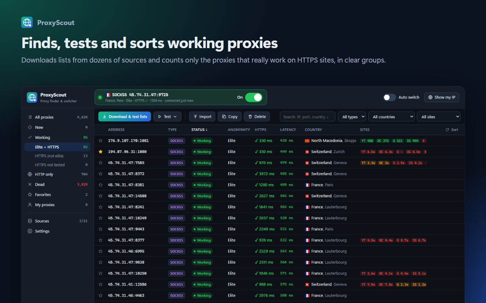
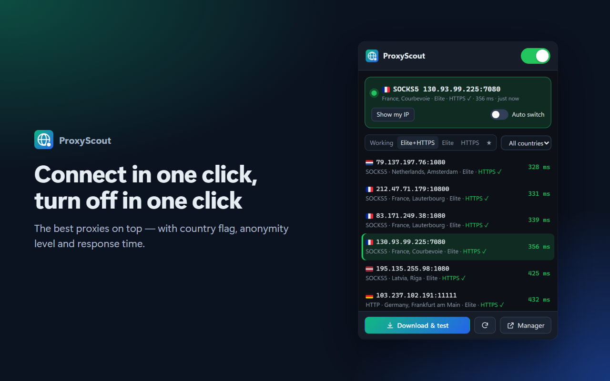
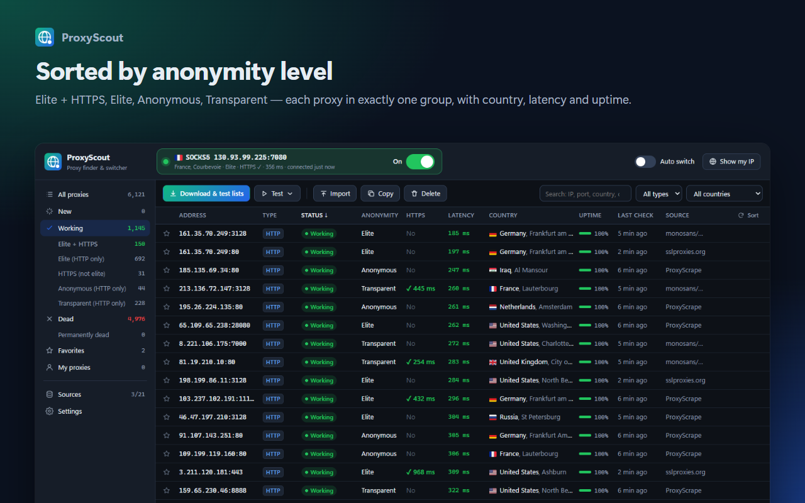
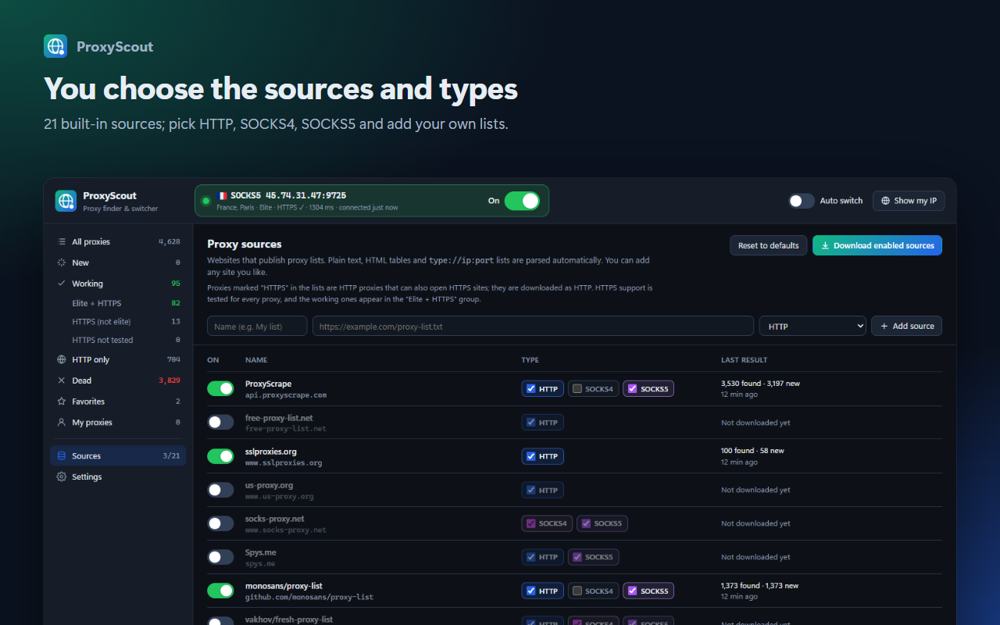
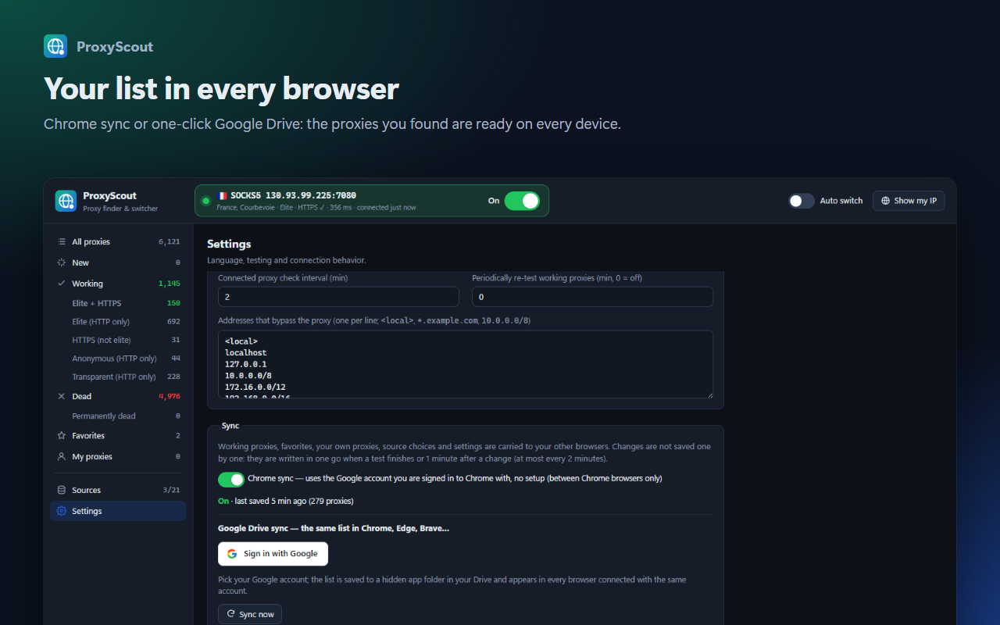

# ProxyScout — Proxy Finder & Switcher

[](https://github.com/Halil-KAPLAN/ProxyScout/actions/workflows/release.yml)
[](https://github.com/Halil-KAPLAN/ProxyScout/releases/latest)
[](LICENSE)

**English** · [Türkçe](README.tr.md)

A Chrome / Edge extension in the spirit of *Proxy Switcher*. ProxyScout downloads free proxy lists
from dozens of sources, really tests every proxy (HTTP **and** HTTPS), sorts the working ones into
**Elite + HTTPS / Elite / Anonymous / Transparent** groups and the rest into **Dead**. Click a proxy and
all browser traffic goes through it; one switch turns it off again.



| | |
| --- | --- |
|  |  |
|  |  |

## Install

### From the stores (recommended)

| Browser | Link |
| --- | --- |
| Chrome, Brave, Opera, Vivaldi | **Chrome Web Store** — _awaiting review_ <!-- CWS_LINK --> |
| Microsoft Edge | **Edge Add-ons** — _awaiting review_ <!-- EDGE_LINK --> |
| Firefox (desktop, 140+) | **Firefox Add-ons** — _awaiting review_ <!-- AMO_LINK --> |

### From GitHub (developer mode)

1. Download `proxyscout-x.y.z.zip` from the [latest release](https://github.com/Halil-KAPLAN/ProxyScout/releases/latest)
   and extract it (or clone the repository and use the `extension` folder).
2. Open `chrome://extensions` (Edge: `edge://extensions`).
3. Turn on **Developer mode** (top right).
4. **Load unpacked** → select the extracted folder (or `extension`).
5. Pin ProxyScout from the puzzle icon in the toolbar.

The manager page opens automatically after the first install.

**Firefox (temporary, for testing):** run `npm run build`, open `about:debugging#/runtime/this-firefox` →
**Load Temporary Add-on…** → select `dist/firefox/manifest.json`. Temporary add-ons are removed when
Firefox closes; use the Firefox Add-ons store for a permanent install.

## Features

- **21 built-in list sources** (ProxyScrape, free-proxy-list.net, Spys.me, monosans, TheSpeedX, …).
  Each source is one row; choose **HTTP / SOCKS4 / SOCKS5** per source and add your own list URLs.
  Plain text, HTML tables and `type://ip:port` lists are parsed automatically.
- **Real tests:** every proxy is tested over HTTP, then with **two separate HTTPS connections**.
  Proxies that load a tiny test page but fail on real websites are filtered out.
- **Anonymity groups that never overlap:** Elite + HTTPS · Elite (HTTP only) · HTTPS (not elite) ·
  Anonymous · Transparent. Every working proxy is in exactly one group.
- **Country, city and flag** for every proxy as soon as it is downloaded (offline database), plus
  city/ISP for working proxies.
- **One-click connect** from the popup or by double-clicking in the manager; **one switch** to turn it
  on and off. The toolbar icon shows the state: green connected, amber connecting, red not responding,
  grey off.
- **Auto switch:** if the connected proxy dies, ProxyScout moves to the best working proxy.
- **Sync** your list across browsers with Chrome sync or Google Drive.
- English and Turkish interface (follows the browser language), dark and light themes.
- No ads, no tracking, no account needed.

## Usage

| Action | Where |
| --- | --- |
| Download and test lists | Popup or manager → **Download & test lists** |
| Connect to a proxy | Click it in the popup, **double-click** the row in the manager, or **Connect**. A **Connecting** spinner is shown while the connection is verified; the result (latency or error) appears as a notification |
| Turn the proxy on / off | One switch: inside the connection card in the manager, at the top of the popup. Its color shows the state; turning it off also cancels a pending connection |
| Sort the list | Click a column header or **Sort**. The list stays put while connecting or testing and is re-sorted when a test finishes |
| Re-test working / dead proxies | **Test ▾** menu (selected, visible, new, working, dead, all) |
| Clean up dead proxies | **Delete ▾** → delete permanently dead / all dead |
| Add your own proxies | **Import** (`ip:port`, `socks5://ip:port`, `user:pass@ip:port`, `ip:port:user:pass`) |
| Choose sources | Sidebar → **Sources**: an on/off switch and **HTTP / SOCKS4 / SOCKS5** checkboxes per site |
| Add a list website | **Sources** → enter URL and type → **Add source** |
| Language | **Language** at the bottom left or **Settings → Language**: Türkçe, English or *Automatic* (default) |
| Auto switch | Switches to the best working proxy if the connected one dies |
| See your exit IP | **Show my IP** |

Manager shortcuts: double-click = connect, `Enter` = connect to selected, `Del` = delete,
`Ctrl+A` = select all, `Shift/Ctrl+click` = multi-select.

## Categories

Working proxies are grouped by two properties: **anonymity level** and **HTTPS support**.
The groups never overlap and add up to the "Working" count.

- **Elite + HTTPS** – the best: works on every site and reveals neither your IP nor that you use a proxy.
- **Elite (HTTP only)** – elite, but does not work with HTTPS sites (or the HTTPS test was not run).
- **HTTPS (not elite)** – anonymous/transparent proxies that work with HTTPS. On HTTPS sites the
  connection is encrypted so your IP is not revealed; on `http://` sites the proxy (and, if
  transparent, your IP) is visible.
- **Anonymous (HTTP only)** – hides your IP but sends proxy headers (`Via`, `X-Forwarded-For`).
- **Transparent (HTTP only)** – leaks your real IP (do not use for privacy).
- **Permanently dead** – failed N times in a row (configurable in Settings).

The HTTPS column shows the response time measured in the HTTPS test. The popup opens on the
"Elite+HTTPS" tab; proxies that fail HTTPS are marked "⚠ No HTTPS".

## How it works

Browser extensions cannot open raw TCP connections, so the tests use the browser's own network stack:
the extension installs a single **PAC script**. A test request carries the proxy as `TYPE~ip~port`
behind a random per-install token, and the PAC script routes only that request through that proxy.
Hundreds of proxies are tested in parallel without affecting normal browsing.

1. **HTTP test** – `http://httpbin.org/get` is requested through the proxy. The returned IP and headers
   tell whether it works, its anonymity level and its latency. Proxies that modify content (inject ads
   or pages) are rejected.
2. **HTTPS test** – every proxy that passed (SOCKS included) opens **two separate** HTTPS connections to
   Cloudflare; both must return the proxy's exit IP, which filters out unstable proxies. The test host
   (`pxs…-<type>-<ip>-<port>-….cloudflareaccess.com`) carries the proxy in its name, so all proxies are
   tested at once without changing the PAC script. Measured with `tests/bench.mjs`: real websites
   (Wikipedia, GitHub, Bing) opened **83%** of the time through proxies that passed, **7%** through
   those that failed. The chosen proxy is verified again over HTTPS when you connect; if it does not
   respond and *Auto switch* is on, the next best proxy is tried.
3. **Location** – the country of every proxy comes from an offline IP → country database (DB-IP Lite)
   bundled with the extension, so flags appear immediately for all proxies. City and ISP of working
   proxies are looked up via ip-api.com (by exit IP, which is more accurate). Windows cannot draw flag
   emojis, so the extension ships a small flag font.

While connected all traffic goes through the selected proxy; if the proxy dies, traffic does **not**
fall back to a direct connection (no IP leak). Local network addresses and the bypass list in Settings
go direct.

## Sync (the same list in all your browsers)

The list you build in one browser shows up in your other browsers — no need to search again.
Managed in **Settings → Sync**.

**What is synced?** Working proxies (with test results and countries), favorites, proxies you added
(including username/password), source choices and settings. Thousands of dead/untested proxies are not
synced; every device can download them again. The summary is compressed: 3,000 proxies ≈ 75 KB.

**How often?** Not on every change. It is written **in one go** when a test finishes or 1 minute after a
manual change (favorite, import, setting, source), at most every 2 minutes — a few dozen writes a day,
far below the limits of both methods. Newer remote data is fetched and merged before writing
(field-level "last writer wins"). Other devices pick up changes at startup, when Chrome sync delivers
them and every 15 minutes.

### Chrome sync (default, no setup)

Uses the Google account you are signed in to Chrome with (`chrome.storage.sync`). The list appears in
every Chrome signed in with the same account, on any computer. Works between Chrome browsers only
(Edge syncs among Edge browsers with its own account). **Extensions** must be enabled in Chrome's sync
settings.

### Google Drive sync (Chrome, Edge, Brave, …)

Settings → Sync → **Sign in with Google** → pick your account. That's it: "Connected as …@gmail.com"
is shown and every browser connected with the same account gets the same list. The list is kept as a
single file in a hidden app folder in your Drive that only this extension can access (`drive.appdata`
scope; your other files are not visible). Google access tokens last one hour; the extension renews them
silently for the account you chose.

### Developer: configuring Google sign-in once

> `BUILTIN_CLIENT_ID` in this repository belongs to the developer's own Google Cloud project. If you
> fork and distribute your own build, create your own client with the steps below.

Google does not let any app access Drive without a registered OAuth client. Extensions like
Tampermonkey embed such a client once so users never see it; ProxyScout does the same (~10 minutes,
once):

1. <https://console.cloud.google.com> → **New project** (e.g. "ProxyScout").
2. **APIs & Services → Library** → "Google Drive API" → **Enable**.
3. **Google Auth Platform → Branding / Audience**: app name **ProxyScout** (shown as "Continue to
   ProxyScout" in the account chooser), support e-mail, audience **External**. **Data Access**: add
   `.../auth/drive.appdata`, `openid`, `.../auth/userinfo.email` (all non-sensitive).
4. **Clients → Create client** → type **Web application** → **Authorized redirect URIs**:
   `https://<extension-id>.chromiumapp.org/` (shown in Settings → Sync → Advanced, with a **Copy** button).
5. Put the **Client ID** (`…apps.googleusercontent.com`) into `BUILTIN_CLIENT_ID` in
   `extension/lib/drive.js` and reload the extension. The client ID is not a secret; the client
   **secret** is not used and must not be added to the extension.
6. Publishing status: in **Testing** only listed test users (max. 100) can sign in. To let everyone in,
   **Publish app** (Branding needs a homepage and privacy policy URL); the requested scopes are
   non-sensitive, so no app verification should be required.

Users can also enter their own client in **Settings → Sync → Advanced**.

### About the extension ID

Sync requires the extension to have the same ID on every computer, so `manifest.json` contains a fixed
`key` (development ID: `bbhjnmkfdcibcmeikpmpcobfkiajfklc`). The stores assign their own IDs and reject
the `key` field — `npm run build` strips it from the store package. The private key needed to pack the
extension (`extension-key.pem`) is **not** in the repository; keep it secret.

## Limitations

- Free/public proxies are not trustworthy: they can see or modify unencrypted (`http://`) traffic.
  Do not use them for logins or sensitive tasks. HTTPS sites stay end-to-end encrypted.
- Chrome/Edge do not support username/password for SOCKS5 proxies (HTTP proxies are supported);
  Firefox supports both.
- Supported browsers: Chromium-based (Chrome, Edge, Brave, Opera, Vivaldi) and Firefox 140+. Only one
  extension can control the proxy setting at a time — disable other proxy/VPN extensions.
- Firefox: if you added private proxies with a username/password, their credentials are synced only after
  you grant the optional "authentication information" data permission (Settings → Sync → **Sync now**).
  Firefox sync uses your Mozilla account and only works between Firefox browsers.
- While connected, list downloads (HTTPS sources) go through the active proxy.
- City and ISP are looked up only for working proxies (the free ip-api.com tier allows 15 batch
  requests per minute).
- The bundled country database is updated monthly; run `node tools/build-geo.mjs` to refresh it.
- Deletions are not synced: a working proxy deleted on one device can come back from another device on
  the next sync (removing a favorite does sync).

## Release and automatic deployment

On every push to `main`, GitHub Actions runs the tests
([`.github/workflows/release.yml`](.github/workflows/release.yml)). If there is no `vX.Y.Z` tag yet for
the version in `extension/manifest.json`, it also:

1. builds the store packages (`npm run build` → `dist/proxyscout-<version>.zip` for Chrome/Edge and
   `dist/proxyscout-firefox-<version>.zip` for Firefox),
2. creates a GitHub Release with both packages,
3. uploads them to the **Chrome Web Store**, **Edge Add-ons** and **Firefox Add-ons** and submits them
   for review.

To ship a fix, bump the version and push:

```
npm run bump            # 1.2.1 → 1.2.2  (also: minor / major / 1.3.0)
git commit -am "Version 1.2.2"
git push
```

Pushes without a version bump only run the tests.

To check the store secrets without uploading anything: **Actions → Release → Run workflow → "Yalnızca
mağaza anahtarlarını sına"**.

### One-time store setup

Store descriptions, permission justifications and images (EN/TR):
[`store/LISTING.md`](store/LISTING.md) and the [`store/`](store) folder.

The **first version is uploaded manually** in each store's dashboard (zip from `npm run build` or the
[Releases](https://github.com/Halil-KAPLAN/ProxyScout/releases/latest) page); later versions are sent by
the workflow. Add the secrets under **Settings → Secrets and variables → Actions**; a store is skipped
when its secrets are missing.

**Chrome Web Store** (one-time USD 5 developer registration, 2-step verification required)

1. <https://chrome.google.com/webstore/devconsole> → **New item** → upload the zip, fill in the listing,
   screenshots and **Privacy** tab (privacy policy:
   `https://github.com/Halil-KAPLAN/ProxyScout/blob/main/PRIVACY.md`) → submit for review.
2. Item ID → `CWS_EXTENSION_ID`, publisher ID (Account page) → `CWS_PUBLISHER_ID`.
3. In Google Cloud enable the "Chrome Web Store API" and create an OAuth client (Web application,
   redirect URI `https://developers.google.com/oauthplayground`) → `CWS_CLIENT_ID`, `CWS_CLIENT_SECRET`.
4. In the [OAuth 2.0 Playground](https://developers.google.com/oauthplayground) use your own client and
   authorize the `https://www.googleapis.com/auth/chromewebstore` scope; the **refresh token** →
   `CWS_REFRESH_TOKEN`.

**Microsoft Edge Add-ons** (free)

1. <https://partner.microsoft.com/dashboard/microsoftedge> → **Create new extension** → upload the zip,
   fill in the details → submit.
2. The extension's **Product ID** → `EDGE_PRODUCT_ID`.
3. **Publish API** page → **Create API credentials** → `EDGE_CLIENT_ID`, `EDGE_API_KEY`
   (API keys expire; update the secret when renewed).

**Firefox Add-ons** (free)

1. <https://addons.mozilla.org/developers/> → **Submit a New Add-on** → *On this site* → upload
   `dist/proxyscout-firefox-<version>.zip`. No source code upload is needed (the code is not minified or
   bundled). Fill in the listing → submit.
2. **Tools → Manage API Keys** → generate credentials → JWT issuer → `AMO_JWT_ISSUER`, JWT secret →
   `AMO_JWT_SECRET`.
3. The Firefox add-on ID is fixed in the build (`proxyscout@halil-kaplan.github.io`); never change it, or
   updates become a new add-on.

**Store IDs and Google sign-in:** the stores give the extension their own IDs. For Google Drive sync to
work in the store builds, add two more redirect URIs to the OAuth client (**Google Auth Platform →
Clients → ProxyScout Extension**): `https://<chrome-store-id>.chromiumapp.org/` and
`https://<edge-store-id>.chromiumapp.org/`. Firefox uses `https://<hash>.extensions.allizom.org/`, derived
from the add-on ID; Settings → Sync shows the exact address. Update the links in the "Install" table once
the stores are live.

## Development

No build step: edit the files and reload the extension in `chrome://extensions`.

### Building the store packages (also for add-on reviewers)

- **Requirements:** any OS (Windows, macOS or Linux) with **Node.js 20 or newer** (tested with 22.14).
  No npm packages are needed: the build has no dependencies and no network access.
- **Command:** `node tools/build-zip.mjs` (same as `npm run build`).
- **Output:** `dist/proxyscout-<version>.zip` (Chrome/Edge), `dist/proxyscout-firefox-<version>.zip`
  (Firefox) and `dist/firefox/` (the Firefox package unpacked). File dates in the zips are fixed, so the
  same source always produces byte-identical packages.
- **What the build does:** copies `extension/` unchanged except that it removes `key` from the Chrome
  manifest and, for Firefox, generates a Manifest V2 `manifest.json` (`firefoxManifest()` in
  `tools/build-zip.mjs`), adds `background.html` and inserts `<script src="lib/firefox-shim.js">` into
  `manager.html` and `popup.html`. No code is transpiled, minified or bundled.

The Firefox package is generated from the same files by `npm run build` (`dist/firefox/`): Manifest V2
with a persistent background page, so the `proxy.onRequest` listener never sleeps and traffic cannot
leak around the proxy while connected.

```
extension/
  manifest.json          Manifest V3 (Chrome/Edge; the Firefox MV2 manifest is generated by build-zip.mjs)
  background.js          download, test, connect, auto switch, sync (service worker / Firefox background page)
  lib/pac.js             PAC script generation and the same decision in JS (Firefox proxy.onRequest)
  lib/platform.js        Chrome/Firefox differences, Firefox data-collection permission
  lib/firefox-shim.js    Firefox only: maps chrome.* to the promise-based browser.*
  lib/parse.js           list parser
  lib/sources.js         built-in sources
  lib/geoip.js           offline IP → country lookup (data/ipv4-country.bin)
  lib/sync.js            sync snapshot: build, merge, compress, chrome.storage.sync packing
  lib/drive.js           Google Drive appDataFolder client and OAuth helpers
  lib/i18n.js            language selection and translation helpers
  lib/messages.js        English / Turkish strings (add new languages here)
  lib/ui.js              shared UI code
  manager.*              full-page manager
  popup.*                toolbar popup
  _locales/              extension name/description translations
  fonts/                 flag font (Twemoji, CC-BY 4.0)
tests/
  logic.test.mjs         parser, PAC and geo database tests
  i18n.test.mjs          translation keys and source structure
  sync.test.mjs          sync snapshot, merge, quota, input validation, Drive client
  firefox.test.mjs       Firefox: PAC/JS decision parity, ProxyInfo, generated manifest
  e2e.mjs                end-to-end test in Chrome for Testing (needs puppeteer)
  e2e-firefox.mjs        end-to-end test in Firefox (needs selenium-webdriver): auth HTTP/SOCKS5, no leak on dead proxy
  sync-e2e.mjs           two-browser sync test
  bench.mjs              real-site comparison of proxies that passed / failed the HTTPS test
tools/
  build-zip.mjs          store packages: Chrome/Edge and Firefox (npm run build)
  publish.mjs            upload to Chrome Web Store / Edge Add-ons / Firefox Add-ons (used by GitHub Actions)
  bump-version.mjs       bump the version (npm run bump)
  store-assets.mjs       store screenshots and promo tiles (puppeteer)
  build-geo.mjs          country database from DB-IP Lite
  make-icons.mjs         icons
  make-key.mjs           fixed-ID key / print the extension ID
```

```
npm test                 # unit tests (node --test)
npm run build            # dist/proxyscout-<version>.zip
node tests/e2e.mjs <puppeteer folder> [screenshot folder]
```

## Privacy

ProxyScout has no servers and sends no personal data to the developer. See [PRIVACY.md](PRIVACY.md).

## License

[GPL-3.0](LICENSE) © Halil KAPLAN

Third-party data and assets:

- IP → country data: [IP Geolocation by DB-IP](https://db-ip.com) — "IP to Country Lite", CC-BY 4.0.
- Flag font (`extension/fonts/TwemojiCountryFlags.woff2`):
  [country-flag-emoji-polyfill](https://github.com/talkjs/country-flag-emoji-polyfill) (MIT); flag artwork
  [Twemoji](https://github.com/twitter/twemoji) — CC-BY 4.0.
