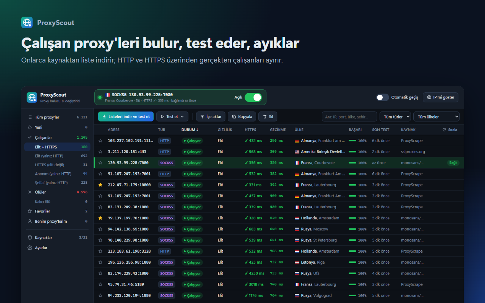
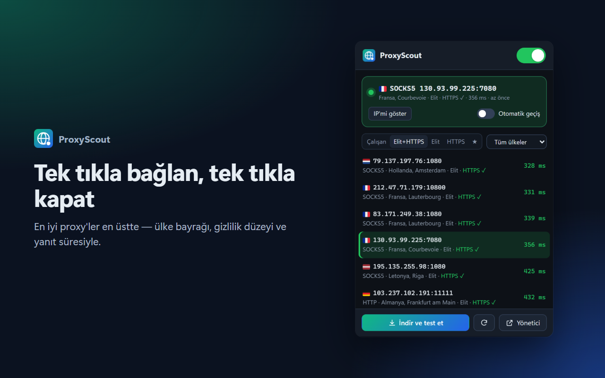
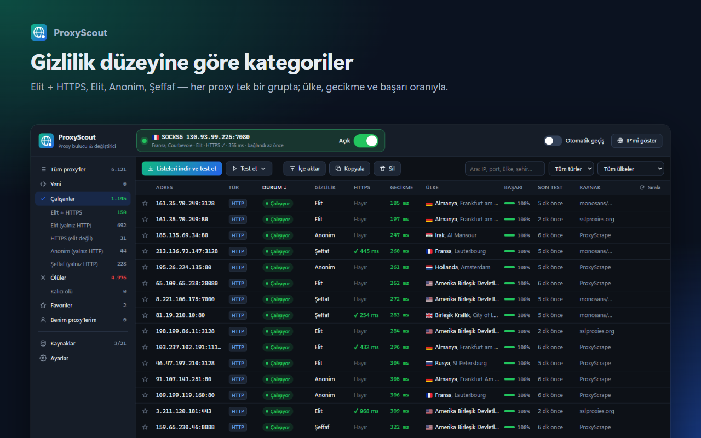
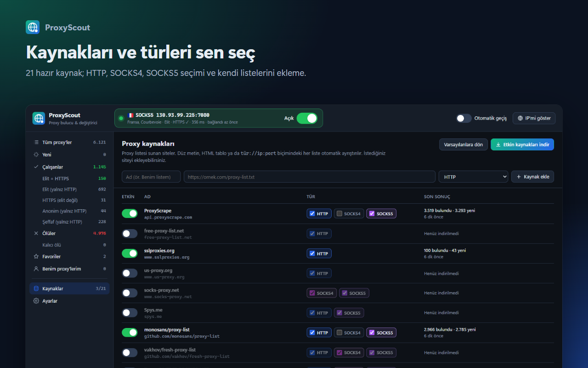
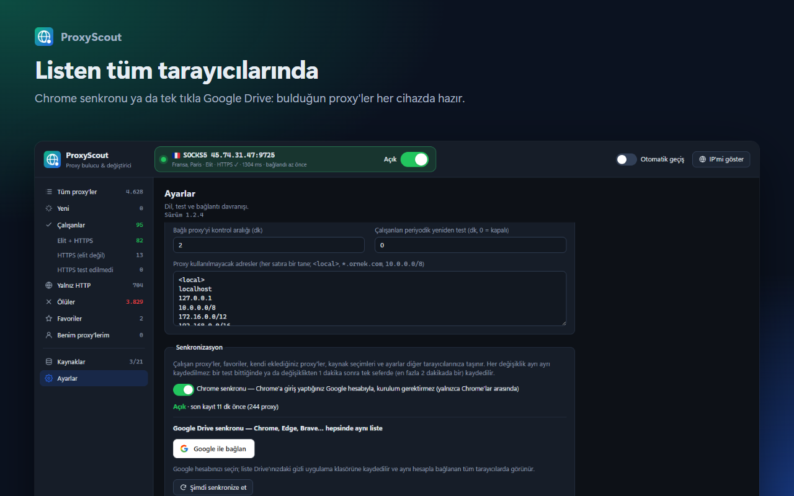

# ProxyScout — Proxy Bulucu ve Değiştirici

[English](README.md) · **Türkçe**

Chrome, Edge, Firefox ve Opera (ve Brave, Vivaldi gibi diğer Chromium tarayıcılar) için proxy bulucu ve
değiştirici. ProxyScout ücretsiz proxy listelerini onlarca kaynaktan indirir, her proxy'yi HTTP ve HTTPS
üzerinden gerçekten test eder ve çalışanları gizlilik düzeyine göre ayırır. Bir proxy'ye tıklayınca tüm
tarayıcı trafiği o proxy üzerinden geçer; tek anahtarla kapatılır.

## Kurulum

| Tarayıcı | Mağaza |
| --- | --- |
| Chrome, Brave, Vivaldi |  |
| Microsoft Edge |  |
| Firefox (masaüstü 140+, Android 142+) |  |
| Opera | **Opera add-ons** — _yayın onayı bekleniyor_ <!-- OPERA_LINK --> |

**Mağazasız (Chromium tarayıcılar):** [son sürümün](https://github.com/Halil-KAPLAN/ProxyScout/releases/latest)
`proxyscout-x.y.z.zip` dosyasını indirip açın, `chrome://extensions` (Edge'de `edge://extensions`)
sayfasında **Geliştirici modu**nu açın ve **Paketlenmemiş öğe yükle** → açtığınız klasörü seçin.

| | |
| --- | --- |
|  |  |
|  |  |

## Özellikler

- **21 hazır liste kaynağı** (ProxyScrape, free-proxy-list.net, Spys.me, monosans, TheSpeedX…), kaynak
  başına **HTTP / SOCKS4 / SOCKS5** seçimi, kendi liste adresleriniz. Varsayılan olarak yalnızca en
  güvenilir kaynaklar açıktır (yaklaşık 500 proxy); daha fazlasını **Kaynaklar**'dan açabilirsiniz.
- **Gerçek test:** her proxy önce HTTP, sonra iki ayrı HTTPS bağlantısıyla test edilir. Küçük bir test
  sayfasını açıp gerçek siteleri açamayan proxy'ler elenir.
- **Yalnızca kullanılabilir proxy'ler çalışan sayılır:** proxy HTTP testini, HTTPS testini ve sayfa yükü
  testini geçmelidir. Her çalışan proxy tam olarak bir gruptadır:
  - **Elit + HTTPS** – HTTPS sitelerde çalışır; ne IP'niz ne de proxy kullandığınız anlaşılır.
  - **HTTPS (elit değil)** – HTTPS sitelerde çalışır; `http://` sitelerde proxy (şeffafsa IP'niz) görünür.
  - **HTTPS test edilmedi** – HTTPS testi kapalıyken HTTP testini geçenler.

  Yalnızca HTTP testini geçenler ayrı bir **Yalnız HTTP** grubunda listelenir: HTTPS siteleri açamadıkları
  için çalışan sayılmazlar. Art arda birkaç kez başarısız olan proxy'ler **Ölüler**e taşınır.
- **Ülke, şehir ve bayrak:** her proxy için (çevrimdışı ülke veritabanı; çalışanlar için şehir ve
  servis sağlayıcı).
- **Tek tıkla bağlanma**, **tek anahtarla** kapatma. Araç çubuğu ikonu durumu gösterir: yeşil bağlı,
  turuncu bağlanıyor, kırmızı yanıt yok, gri kapalı.
- **IP sızıntısı yok:** bağlı proxy ölürse trafik doğrudan bağlantıya düşmez. **Otomatik geçiş**
  açıksa sıradaki en iyi çalışan proxy'ye geçilir.
- **Senkron:** tarayıcının kendi senkronu ya da Google Drive ile tüm tarayıcılarınızda aynı liste.
- Türkçe ve İngilizce arayüz, koyu ve açık tema. Reklam yok, izleme yok, hesap gerekmez.

## Kullanım

| İşlem | Nerede |
| --- | --- |
| Listeleri indir ve test et | Popup veya yönetici → **Listeleri indir ve test et** |
| Proxy'ye bağlan | Popup'ta proxy'ye tıklayın ya da yönetici sayfasında satıra **çift tıklayın** |
| Proxy'yi kapat | Popup'ın üstündeki ya da yöneticideki bağlantı kartındaki anahtar |
| Yeniden test et, temizle | **Test et ▾** (seçilenler, yeniler, çalışanlar, ölüler…) ve **Sil ▾** (ölüler) |
| Kendi proxy'lerinizi ekleyin | **İçe aktar** (`ip:port`, `socks5://ip:port`, `kullanıcı:şifre@ip:port`, `ip:port:kullanıcı:şifre`) |
| Kaynak seçin ya da ekleyin | Sol menü → **Kaynaklar** (telefonda: üstteki ⚙ → **Kaynaklar**) |

Kısayollar (yönetici): `Enter` = seçiliye bağlan, `Del` = sil, `Ctrl+A` = tümünü seç,
`Shift/Ctrl+tık` = çoklu seçim.

## Nasıl çalışıyor?

Eklentiler ham bağlantı açamadığı için ProxyScout proxy'leri tarayıcının kendisiyle test eder: bir PAC
betiği her test isteğini yalnızca test edilen proxy'ye yönlendirir; böylece yüzlerce proxy, normal
gezintiyi etkilemeden aynı anda test edilir. Proxy önce HTTP üzerinden `httpbin.org`'u açmalıdır (çıkış
IP'si ve başlıklar gizlilik düzeyini gösterir), sonra Cloudflare'e iki ayrı HTTPS bağlantısı kurmalıdır.
Ölçümlerimizde testi geçen proxy'lerin **%83**'ü, geçemeyenlerin **%7**'si gerçek siteleri açabildi.
Ülkeler eklentiyle gelen çevrimdışı veritabanından (DB-IP Lite), çalışan proxy'lerin şehri ve servis
sağlayıcısı ip-api.com'dan gelir.

## Senkronizasyon

Bir tarayıcıda oluşturduğunuz liste diğer tarayıcılarınızda da görünür (**Ayarlar → Senkronizasyon**).
Çalışan proxy'ler, favoriler, kendi eklediğiniz proxy'ler (kullanıcı adı/şifre dahil), kaynaklar ve
ayarlar taşınır; ölü ve test edilmemiş proxy'ler taşınmaz.

- **Tarayıcı senkronu** (kurulum gerektirmez): tarayıcıya giriş yaptığınız hesapla çalışır, yalnızca
  aynı tarayıcılar arasında (Chrome ↔ Chrome, Edge ↔ Edge, Firefox ↔ Firefox). Opera'da yoktur.
- **Google Drive** (her tarayıcıda): **Google ile bağlan** deyin; aynı hesapla bağlanan tüm
  tarayıcılarda liste aynıdır. Liste Drive'ınızda yalnızca ProxyScout'un erişebildiği gizli bir
  uygulama klasöründe tutulur; diğer dosyalarınızı göremez.

Kendi Google istemcinizi kullanmak için (ör. bir çatalda):
[Configuring Google sign-in](docs/DEVELOPMENT.md#configuring-google-sign-in) (İngilizce).

## Sınırlamalar

- Ücretsiz/açık proxy'ler güvenilir değildir: şifresiz (`http://`) trafiğinizi görebilir veya
  değiştirebilirler. Şifre girdiğiniz ya da hassas işlem yaptığınız sitelerde kullanmayın. HTTPS siteler
  uçtan uca şifreli kalır.
- Chrome, Edge ve Opera, SOCKS5 proxy'lerde kullanıcı adı/şifreyi desteklemez (HTTP proxy'lerde
  destekler); Firefox ikisini de destekler.
- Proxy ayarını aynı anda tek bir eklenti kontrol edebilir; başka bir proxy/VPN eklentisi varsa devre
  dışı bırakın.
- Firefox: kendi proxy'lerinizin kullanıcı adı/şifresi, isteğe bağlı "kimlik doğrulama bilgisi" iznini
  verdikten sonra senkronlanır (Ayarlar → Senkronizasyon → **Şimdi senkronize et**).
- Bağlıyken liste indirme aktif proxy üzerinden yapılır.
- Silme işlemleri senkronlanmaz: bir cihazda silinen çalışan proxy başka bir cihazdan geri gelebilir.

## Geliştirme

Derleme adımı yoktur: `extension/` klasörünü düzenleyip eklentiyi yenileyin. `npm test` birim
testlerini çalıştırır; `npm run build` (Node.js 20+, bağımlılık yok) mağaza paketlerini `dist/`
klasörüne üretir. Derleme, testler, yayın ve mağaza kurulumu: [docs/DEVELOPMENT.md](docs/DEVELOPMENT.md)
(İngilizce).

## Gizlilik

ProxyScout'un sunucusu yoktur ve geliştiriciye hiçbir kişisel veri göndermez. Bkz. [PRIVACY.md](PRIVACY.md).

## Lisans

[GPL-3.0](LICENSE) © Halil KAPLAN

Üçüncü taraf veri ve varlıklar:

- IP → ülke verisi: [IP Geolocation by DB-IP](https://db-ip.com) — "IP to Country Lite", CC-BY 4.0.
- Bayrak fontu (`extension/fonts/TwemojiCountryFlags.woff2`):
  [country-flag-emoji-polyfill](https://github.com/talkjs/country-flag-emoji-polyfill) (MIT); bayrak
  çizimleri [Twemoji](https://github.com/twitter/twemoji) — CC-BY 4.0.
